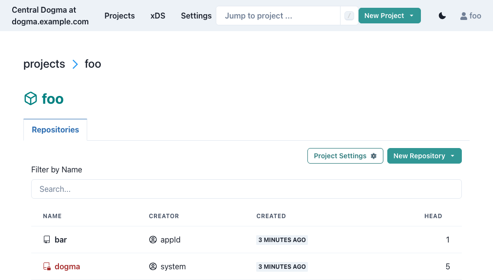
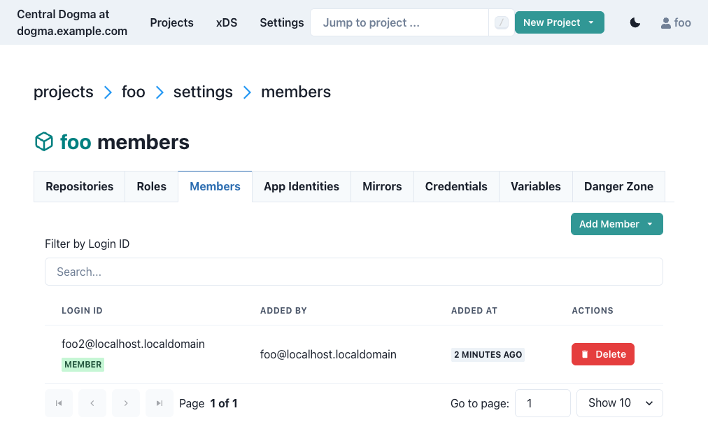
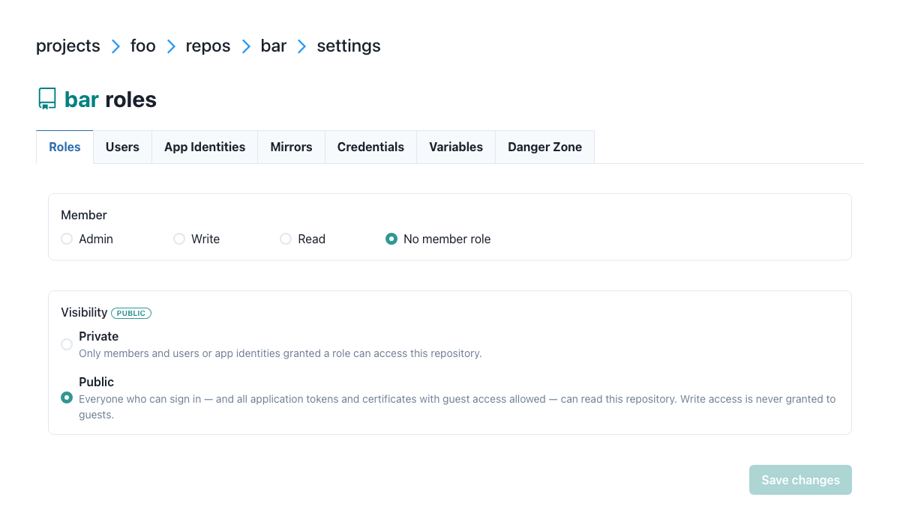
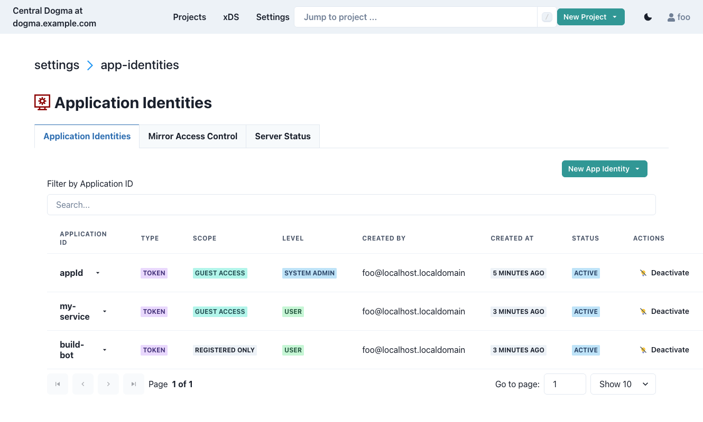

# Authentication and Access Control

Central Dogma provides the following modules to configure its authentication layer:

- `server-auth-saml`, which is based on [OpenSAML](https://wiki.shibboleth.net/confluence/display/OS30/Home)
- `server-auth-shiro`, which is based on [Apache Shiro](https://shiro.apache.org/)

They are included in the distribution by default so that you can configure the authentication layer with
the following instruction.

## Basic authentication configuration

The first step to configure the authentication layer is adding `authentication` property to the
`conf/dogma.json`. The authentication is disabled when `authentication` property is `null`.
The authentication configuration consists of the following properties:

```json
{
  ...
  "authentication": {
    "factoryClassName": "the fully-qualified class name of an AuthenticationProviderFactory",
    "systemAdministrators": [],
    "caseSensitiveLoginNames": false,
    "sessionCacheSpec": "maximumSize=8192,expireAfterWrite=604800s",
    "sessionTimeoutMillis": 604800000,
    "sessionValidationSchedule": "0 30 */4 ? * *",
    "properties": null
  }
}
```

- `factoryClassName` (string)

  - the fully-qualified class name of the [AuthProviderFactory](type) implementation.
    Can be one of
    `com.linecorp.centraldogma.server.auth.saml.SamlAuthProviderFactory` or
    `com.linecorp.centraldogma.server.auth.shiro.ShiroAuthProviderFactory`.

- `systemAdministrators` (string array)

  - login names of the system administrators. A user who has a login name specified here will get the
    system administrator role.

- `caseSensitiveLoginNames` (boolean)

  - whether case-sensitive matching is performed when login names are compared. Disabled by default
    (case-insensitive).

- `sessionCacheSpec` (string)

  - the cache specification string which determines the capacity and behavior of the cache for the session
    information of the server. Refer to [the Caffeine API documentation](https://static.javadoc.io/com.github.ben-manes.caffeine/caffeine/2.6.2/com/github/benmanes/caffeine/cache/CaffeineSpec.html) for more information.

- `sessionTimeoutMillis` (integer)

  - the session timeout for web-based administrative console, in milliseconds. If `null`, the default value
    of '604800000 milliseconds' (7 days) is used.

- `sessionValidationSchedule` (string)

  - a [Quartz cron expression](https://www.quartz-scheduler.org/documentation/quartz-2.3.0/tutorials/crontrigger.html)
    that describes when the task for revalidating the existing sessions is
    supposed to be triggered. If unspecified, `0 30 */4 ? * *` (at 0:30, 4:30, 8:30, 12:30, 16:30 and 20:30
    for every day) is used.

- `properties` (object)

  - an object which describes authentication provider specific properties.

## Configuring authentication with SAML

[Security Assertion Markup Language (SAML)](https://en.wikipedia.org/wiki/Security_Assertion_Markup_Language)
is an open standard for exchanging authentication and authorization
data between an identity provider and a service provider. In this protocol, Central Dogma acts as a service
provider. So, you need to fill the `properties` with information of an identity provider that you delegate
the authentication to.

```json
{
  ...
  "authentication": {
    "factoryClassName": "com.linecorp.centraldogma.server.auth.saml.SamlAuthProviderFactory",
    "systemAdministrators": [],
    "caseSensitiveLoginNames": false,
    "sessionCacheSpec": "maximumSize=8192,expireAfterWrite=604800s",
    "sessionTimeoutMillis": 604800000,
    "sessionValidationSchedule": "0 30 */4 ? * *",
    "properties": {
      "entityId": "dogma",
      "hostname": "dogma-example.linecorp.com",
      "signingKey": "signing",
      "encryptionKey": "encryption",
      "keyStore": {
        "type": "PKCS12",
        "path": "./conf/saml.jks",
        "password": null,
        "keyPasswords": {
          "signing": null,
          "encryption": null
        },
        "signatureAlgorithm": "http://www.w3.org/2001/04/xmldsig-more#rsa-sha256"
      },
      "acs": {
        "endpoints": [
          {
            "uri": "https://dogma-example.linecorp.com/saml/acs/post",
            "binding": "HTTP_POST"
          },
          {
            "uri": "https://dogma-example.linecorp.com/saml/acs/redirect",
            "binding": "HTTP_REDIRECT"
          }
        ]
      },
      "idp": {
        "entityId": "some-idp",
        "uri": "https://idp.some-service.com/saml/single_sign_on_service",
        "binding": "HTTP_POST",
        "signingKey": "some-idp",
        "encryptionKey": "some-idp",
        "subjectLoginNameIdFormat": "urn:oasis:names:tc:SAML:1.1:nameid-format:emailAddress",
        "attributeLoginName": null
      }
    }
  }
}
```

The following describes the meaning of SAML-specific properties.

- `entityId` (string)

  - an identifier of this service provider.

- `hostname` (string)

  - a host name which is used for generating URLs for an assertion consumer service, a metadata service and
    a single logout service that are served by this service provider. It should be accessible from a user
    browser.

- `signingKey` (string)

  - the name of a private key which is used for signing. If unspecified, `signing` is used by default.
    Executing [keytool](https://docs.oracle.com/en/java/javase/11/tools/keytool.html) with `-genkeypair` command
    helps you to create a new key pair in your keystore.

- `encryptionKey` (string)

  - the name of a private key which is used for encryption. If unspecified, `encryption` is used by default.

- `keyStore`

  - the keystore which is used to encrypt and decrypt exchanged messages.
  - `type` (string)

    - the type of the keystore. If unspecified, the type retrieved from
      `java.security.KeyStore.getDefaultType()` is used by default.

  - `path` (string)

    - the location of the keystore file.

  - `password` (string)

    - the password of the keystore.

  - `keyPasswords` (map of string key-value pairs)

    - a map of a key name and its password. If the password is unspecified, the empty string is used by default.

  - `signatureAlgorithm` (string)

    - a name of the signature algorithm for signing and encryption.
      If unspecified, the legacy `http://www.w3.org/2000/09/xmldsig#rsa-sha1` algorithm is used by default.
      Configure `http://www.w3.org/2001/04/xmldsig-more#rsa-sha256` for stronger signatures.

- `acs`

  - the assertion consumer service configuration. If unspecified, the default value is used which is
    `{scheme}://{hostname}:{port}/saml/acs/post` and `{scheme}://{hostname}:{port}/saml/acs/redirect`.
  - `endpoints` (array of object)

    - an array of assertion consumer service endpoints. Each endpoint has the following properties:

    - `uri` (string)

      - a uri where a SAML response is supposed to be sent to.

    - `binding` (string)

      - a binding protocol of the `uri`. It can be one of `HTTP_POST` or `HTTP_REDIRECT`.
        If unspecified, `HTTP_POST` is used by default.

- `idp`

  - the identity provider configuration.
  - `entityId` (string)

    - an identifier of the identity provider.

  - `uri` (string)

    - a URL where an authentication request is supposed to be sent to.

  - `binding` (string)

    - a binding protocol of the `uri`. If unspecified, `urn:oasis:names:tc:SAML:2.0:bindings:HTTP-POST`
      is used by default. It can be simply specified as `HTTP_POST` or `HTTP_REDIRECT`.

  - `signingKey` (string)

    - the name of a certificate for signing, which is provided by the identity provider.
      If unspecified, the `entityId` is used by default. Executing
      [keytool](https://docs.oracle.com/en/java/javase/11/tools/keytool.html) with `-importcert` command
      helps you to import a certificate of an identity provider to your keystore.

  - `encryptionKey` (string)

    - the name of a certificate for encryption, which is provided by the identity provider.
      If unspecified, the `entityId` is used by default.

  - `subjectLoginNameIdFormat` (string)

    - the name ID format of a subject which holds a login name.
      If unspecified, `urn:oasis:names:tc:SAML:1.1:nameid-format:emailAddress` is used by default.
      It means that the email address handed from the identity provider is used as a login name in the
      authentication layer. You need to consult with the metadata of the identity provider before configuring
      this property.

  - `attributeLoginName` (string)

    - the attribute name which holds a login name. Some identity provider provides a login name by an attribute,
      instead of a name ID. In this case, you can configure this property, and then set `subjectLoginNameIdFormat`
      to `null` in order to avoid treating an email address as a login name.

## Configuring authentication with Apache Shiro

[Apache Shiro](https://shiro.apache.org/) is a Java security framework that performs authentication, authorization, cryptography,
and session management. Central Dogma leverages its authentication feature to authenticate a user.
If you want to configure the authentication layer with [Apache Shiro](https://shiro.apache.org/), you should configure the `authentication`
property in your `conf/dogma.json` as follows. Note that the path of your INI configuration file is specified
in the `properties` property.

```json
{
  ...
  "authentication": {
    "factoryClassName": "com.linecorp.centraldogma.server.auth.shiro.ShiroAuthProviderFactory",
    "systemAdministrators": [],
    "caseSensitiveLoginNames": false,
    "sessionCacheSpec": "maximumSize=8192,expireAfterWrite=604800s",
    "sessionTimeoutMillis": 604800000,
    "sessionValidationSchedule": "0 30 */4 ? * *",
    "properties": "./conf/shiro.ini"
  }
}
```

You may configure `conf/shiro.ini` simply as follows, which uses a local database system of [Apache Shiro](https://shiro.apache.org/):

```ini
[users]
system-admin = system-admin-secret
dogma-admin = dogma-admin-secret
```

:::note

[Apache Shiro](https://shiro.apache.org/) supports RDBMS or LDAP based security system as well. You can find the example
configuration files under the `conf/` directory in the distribution.

:::

## Access Control

One way to configure the access control system for Central Dogma is to use the web UI.
For remote access to an authenticated server, expose a public HTTPS endpoint on port 443. Either configure the
server's [HTTPS listener](setup-configuration.mdx#configuring-tls) for port 443 or put a TLS reverse proxy on
port 443 in front of the configured server port. Then open
`https://{your-central-dogma-domain-or-ip}:443` in your web browser.
Use HTTP only for localhost or local development.
You may configure a project with HTTP APIs, but we recommend the web UI because it is easier and simpler.

Anyone who is signed in can create a project and becomes its owner. Project owners can configure it
by choosing **Project Settings** on the project page.



Use the **Members** tab to manage users and the **App Identities** tab to manage application identities.



When you add a user as a member of the project, you need to choose the role of the member.
There are 4 user role types in the access control system of Central Dogma, but you can choose one
of `Owner` and `Member` role in the UI. More information about the role is as follows.

- `System Administrator`

  - the user that all permissions are assigned to, a.k.a 'super user'. Only a system administrator can restore
    removed project. The system administrators can be configured in `conf/dogma.json` as described the above.

- `Owner` of a project

  - the administrator of a project. Owners can create and remove repositories, remove the project, manage
    project members and application identities, and configure their repository roles.

- `Member` of a project

  - users who can see the configuration of a project, but members are not allowed to change the configuration.

- `Guest` of a project

  - users who is logged in but is neither an owner nor a member of a project. Guests are not allowed to see
    the configuration of a project.

:::note

Create an application identity under **Settings → Application Identities** before adding it to a project.

:::

Open **Repository Settings** to configure repository roles. Use **Roles** to set the role granted to
project members and choose the repository's visibility. Use **Users** and **App Identities** to grant
roles to individual users or application identities.



The available repository roles are `READ`, `WRITE`, and `ADMIN`. `ADMIN` includes `WRITE`, and
`WRITE` includes `READ`. A user's effective role is the highest of their direct repository role,
the configured member role if they belong to the project, and any read access granted by public visibility.
Project owners and system administrators have `ADMIN` on every repository in the project.

### Public repositories

A repository whose guest role is `READ` is public. Signed-in users and application tokens or mTLS
certificates with guest access enabled can read it without a repository role. Eligible project
members retain this access even if the repository grants no member role. Writing requires `WRITE` or
`ADMIN`.

Repositories are private by default. If the project allows public repositories, check
**Make this repository public** when creating one or select **Public** later in **Repository Settings → Roles**.

Project owners can disable **Allow public repositories** in **Project Settings** once all public
repositories in the project are private.

### Application Token

When a user uses the web UI, he or she should login first to get a token for a new web session. But what
should a user do when he or she uses one of Central Dogma clients? The user may log in to a Central Dogma
server via HTTP API and get a session token. But it is inconvenient and the user may write more complicated
code because the user should log in again when the session token is expired. `Application Token` would be
useful for this case.

An application token can have project and repository roles like a user. Create one under
**Settings → Application Identities**. Each application identity has a unique application ID.



Anyone who is logged into the Central Dogma can create a new `Application Token`, and the token is shared
for everyone. So any owner of a project can add any token to their project. However only both the token
creator and the system administrator are allowed to deactivate, remove and/or regenerate the token.

If the secret of a token is leaked, the token creator or a system administrator can rotate the secret
without losing the roles and permissions granted to the application ID:

1. Deactivate the token. The leaked secret is revoked and stops authenticating. Note that it may take
   a short time for the change to be propagated to the authorization cache of each server.
2. Regenerate the secret with the `Regenerate secret` button of the web UI or
   `POST /api/v1/appIdentities/{appId}/secret`. A newly-generated secret is issued to the same
   application ID, but it does not authenticate yet because the token is still deactivated. A token
   must be deactivated before its secret is regenerated.
3. Distribute the new secret to the clients of the token.
4. Activate the token. The new secret starts authenticating once the activation is propagated to the
   authorization cache of each server.

There are two levels of a token, which are `System Admin` and `User`. `System Admin` level token can be
created by only the system administrators. A client who sends a request with the token is allowed to access
system administrator-level APIs.

Guest access is off by default for new tokens and mTLS certificates. Enable it at creation to let the
application identity read public repository content without a repository role. System administrator
identities can always read public repositories.
